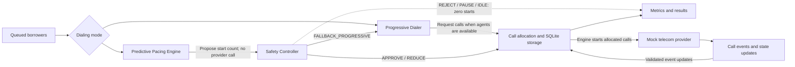

# SmartSimulator Architecture

## Purpose

SmartDialer is a local simulator for selecting queued borrowers, allocating agents, and modeling outbound calls. It supports Progressive and Predictive dialing modes and uses seeded mock providers; it does not connect to telephone carriers.

## End-to-end architecture

## End-to-end workflow

1. Eligible borrowers enter the SQLite queue with priorities; allocation selects the highest-priority eligible borrower.
2. The selected mode determines how a call is requested. Progressive dialing reserves an available agent and a borrower together. Predictive pacing proposes a start count but never starts provider calls itself. Allocation differs by runner: the discrete-time scenario runner reserves a borrower without an agent, while the legacy batch runner's Predictive mode reserves an agent and borrower together.
3. The predictive path sends its proposal and current inputs to Safety. Safety may approve or reduce starts, return zero starts through `REJECT`, `PAUSE`, or `IDLE`, or select Progressive fallback. In the discrete-time scenario runner, only Safety-approved starts proceed. The legacy direct Progressive batch runner allocates within its capacity limits without a Safety approval step.
4. SQLite transactions protect allocations. In the discrete-time scenario runner, an answer to an unassigned Predictive call triggers an atomic attempt to claim an available agent; if none can be claimed, the call becomes `ABANDONED_NO_AGENT`.
5. After allocation, the simulation engine runs a seeded mock provider. Answers can proceed through `CONNECTED` to `COMPLETED`; no-answer and provider-failure outcomes are recorded as `FAILED`.
6. Storage checks event identity, sequence, and allowed state transitions before updating call and agent state. Eligible provider failures can enter bounded retry with backoff. Recovery requeues pre-provider reservations and quarantines provider-started calls as `UNCERTAIN`.
7. Simulation metrics summarize attempts, answers, connections, failures, retries, abandonment, throughput, and agent utilization where the runner supplies the relevant data.

## Main components

| Component | Responsibility |
|---|---|
| Progressive Dialer | Starts calls only when an available agent can be reserved with an eligible borrower. It is also the fallback selected by Safety in the scenario runner. |
| Predictive Pacing Engine | Estimates a proposed call-start count from capacity, pending work, and answer-rate inputs. It proposes pacing but does not initiate provider calls. |
| Safety Controller | Applies availability, provider-health, input-age, concurrency, and abandonment-risk checks to predictive proposals. Its decisions include approval, reduction, rejection, pause, idle, and Progressive fallback. |
| SQLite storage | Persists borrower, call, agent, and event data. Transactions prevent conflicting reservations and validate event-driven state changes. |
| Mock telecom providers | Produce deterministic simulated answer, no-answer, and failure outcomes subject to configured provider limits and availability. |
| Simulation and metrics | Orchestrates allocations and events, then reports aggregates for the local simulation. |

## Safety and reliability choices

- Progressive allocation reserves an agent and borrower in a SQLite write transaction. In the discrete-time scenario runner, Predictive allocation reserves the borrower first and claims an agent atomically when the call is answered; the legacy batch runner's Predictive mode reserves both up front.
- Predictive pacing and provider initiation are separate: the engine uses Safety's approved start count before initiating calls. In the scenario runner, a rejected, paused, or idle decision starts no new calls.
- Provider-scoped event IDs and sequence numbers reject duplicate and stale events; call and agent transitions are checked before being stored.
- Eligible provider failures can be retried with bounded exponential backoff. This is local simulation behavior, not a production retry scheduler.
- Recovery requeues calls that had not reached a provider and quarantines provider-started calls. See the [reliability notes](RELIABILITY.md) for the recovery behavior and other constraints.

## Limitations

This is a single-machine simulator, not a production dialer or telecom integration. Its concurrency and capacity observations do not establish production-scale guarantees. Recovery does not automatically expire uncertain calls. A late `CONNECTED` event is rejected when no agent is associated or when the associated agent is no longer paused; the call stays `UNCERTAIN` for reconciliation rather than risking an unsafe assignment.
