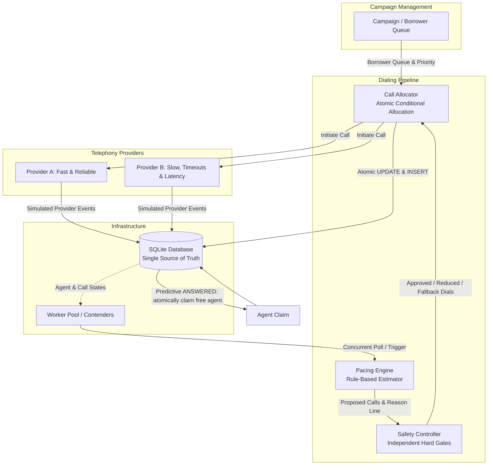
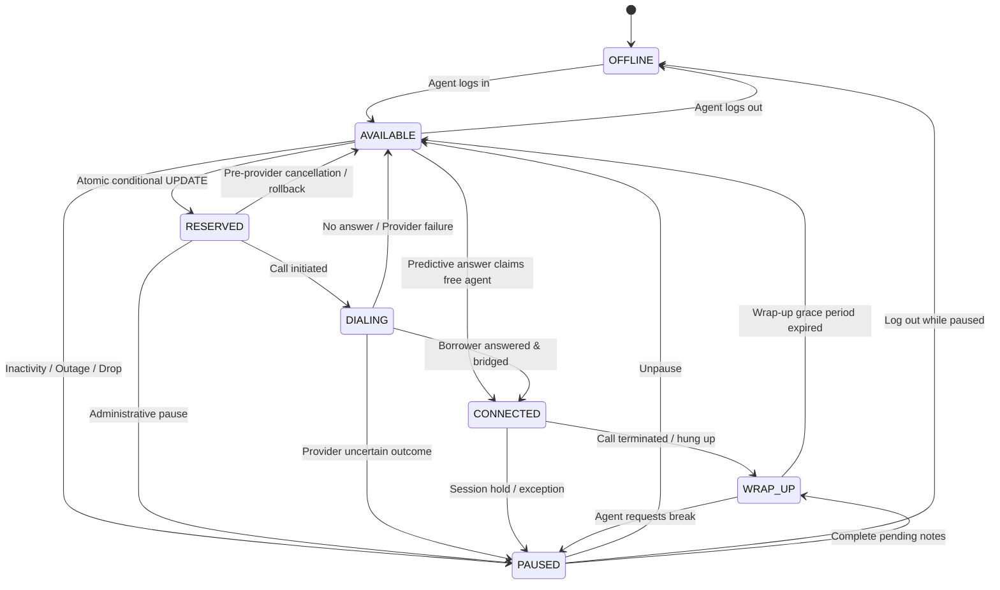
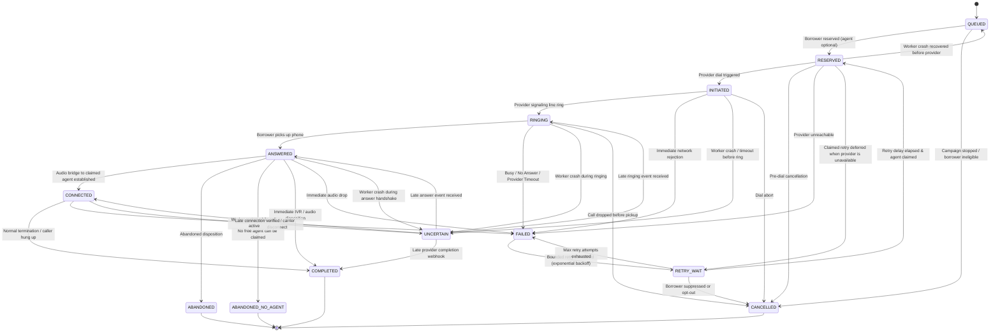

# SmartDialer Architecture

## System Flow & Architecture Diagram



---

## State Machines

### Agent State Machine



### Call State Machine



Predictive dialing reserves an eligible borrower without reserving an agent.
When an answer arrives, the simulator atomically claims an `AVAILABLE` agent;
if none is free, the call transitions to terminal `ABANDONED_NO_AGENT`.
Progressive fallback continues to reserve an agent before initiating a call.
The call state `RESERVED` therefore does not imply that an agent is assigned.

Recovery does not expire `UNCERTAIN` calls automatically. A late `CONNECTED`
event restores the call's associated agent from quarantine only while that agent
remains `PAUSED`. If there is no associated agent, or the associated agent has
moved to another state, the event is rejected so recovery cannot claim or release
another call's agent. A late `COMPLETED` event can move a quarantined associated
agent to `WRAP_UP`.

---

## Concurrency & State Invariants

### 1. How two workers cannot reserve the same agent
Progressive agent reservation uses an atomic conditional update:
```sql
UPDATE agents SET state = 'RESERVED' WHERE id = ? AND state = 'AVAILABLE';
```
In SQLite, this runs inside an exclusive `BEGIN IMMEDIATE` write transaction with `changes() == 1` verification. Even under heavy multi-threaded contention (verified by `test_concurrent_reservation_of_one_agent_by_n_workers` with 8 threads racing for 1 agent), exactly one transaction acquires the write lock and finds `state = 'AVAILABLE'`. All competing workers observe `changes() == 0`, rollback, and receive `None`.

For predictive calls, the answer handler instead conditionally updates an available agent to `CONNECTED` and assigns that agent to the `ANSWERED` call within one `BEGIN IMMEDIATE` transaction. If no agent is available, the call is recorded as terminal `ABANDONED_NO_AGENT`.

### 2. How stale state is handled
In-memory structures (such as sliding windows and worker threads) never hold reservation authority. State is verified at the database level on every state transition (`expected_state` checks). Furthermore, provider events are stamped with monotonically increasing sequence numbers `seq`: any event with `seq <= MAX(seq)` is rejected as `STALE`, and duplicate event IDs are rejected as `DUPLICATE`.

### 3. Which source of truth wins
The SQLite database file is the single, authoritative source of truth. Workers, pacing proposals, and provider adapters are stateless contenders that must validate against the database engine before executing side-effects.

---

## Scale Analysis

The figures below are operational estimates, not measured capacity results. The
100- and 1,000-agent reservation smoke observations were recorded from local runs;
the exact source revision was not captured, and they were not independently
reverified during the documentation update. The 1,000-agent, 16-worker test
intermittently hit SQLite `database is locked` errors when acquiring
`BEGIN IMMEDIATE`. These small synthetic reservation tests do not measure
end-to-end dialing capacity. No 10,000-agent test has been run.

### 100 Agents
The 100-agent/100-borrower/16-worker reservation smoke run completed 100/100 unique reservations with zero worker errors. The ~30–50 concurrent calls estimate is a workload assumption. Neither figure is an end-to-end capacity claim.

### 1,000 Agents
At this scale, SQLite's single-writer serialization can become a bottleneck under concurrent allocation; the local 16-worker smoke test intermittently encountered `database is locked`, while three 8-worker repetitions passed. The ~300–600 concurrent calls and ~50 call-state transitions per second are workload assumptions, not measured results.
- **Specific Fix**: Migrate the storage engine to PostgreSQL. Use row-level locking with `SELECT id FROM agents WHERE state = 'AVAILABLE' FOR UPDATE SKIP LOCKED LIMIT 1`. Partition or shard campaigns across a pool of stateless dialing worker nodes, while an in-memory event bus (e.g. Redis Stream or RabbitMQ) ingests asynchronous carrier events before batching updates to the database.

### 10,000 Agents
10,000-agent capacity is unmeasured. The ~3,000–6,000 active calls and hundreds of state events per second are workload projections, not test results. A centralized relational database table and monolithic pacing loop may encounter lock contention and provider rate limits at this scale.
- **Specific Fix**: Shard agents and borrower campaigns into independent tenant/campaign pods (e.g., 500-1,000 agents per pod with dedicated PostgreSQL schemas/databases). Decouple event ingestion from business logic using a distributed carrier event log (Kafka / Pulsar), with partition keys mapped to `call_id`. Use local memory rate-limiters with token buckets to enforce strict carrier SIP trunking limits, while a distributed safety controller computes partition-level hard caps.
